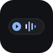

# Pixel Media Chip

An Xposed / LSPosed module for Google Pixel devices that embeds an interactive media player chip directly into the status bar left of the camera punch-hole cutout, inspired by dynamic island ergonomics and Material 3 Expressive motion.

Semi vibecoded by Gemini.



## Features

### Status Bar Media Chip
- Three layout modes:
  - Two lines: Track title and artist with marquee support.
  - One line: Single-row compact scrolling marquee.
  - Icon only: Minimalist pill displaying album art or live equalizer.
- Dynamic Island camera eating: the chip can smoothly extend into and around the front camera cutout with configurable absorption depth.
- Real-time live audio visualizer: 3-band FFT spectrum animation inside the status bar pill, with automatic procedural fallback for protected streams.
- Gesture controls:
  - Tap: Play / pause toggle.
  - Swipe left: Next track.
  - Swipe right: Previous track.
  - Long press: Detach and bloom into the expanded media card popup.
- Monet dynamic coloring: adaptive tinting matching the current album art or wallpaper palette.
- System event adaptation: automatically squishes to icon or hides when system telemetry (screen recording, active calls) appears.

### Expanded Fluid Popup
- Physics-based droplet metamorphosis animation upon opening and dismissing.
- Full media controls: play/pause, skip, rewind, track progress, volume, and like actions.
- Interactive squiggly progress bar and expanded spectrum visualizer.

### Material 3 Expressive Companion App
- Live interactive status bar preview canvas reflecting settings changes in real time.
- One-click presets: Pixel Default, Dynamic Island, Compact, and Expanded.
- Step-snapping sliders with anti-bounce discrete haptic feedback.
- System diagnostics for Root, RECORD_AUDIO, and SYSTEM_ALERT_WINDOW permissions.
- Root-powered one-click SystemUI restart.
- English and Russian localization.

## Architecture

- Injection: Hooks `com.android.systemui.statusbar.phone.PhoneStatusBarView` to inject custom container views into the status bar hierarchy.
- Session Management: Interfaces with `android.media.session.MediaSessionManager` to track active media playback, metadata, and playback states.
- IPC & Persistence: Bidirectional configuration synchronization between the companion settings app and SystemUI via `ContentProvider` (`com.pixel.mediachip.provider`), inter-process broadcasts (`ACTION_SETTINGS_CHANGED`), and local cache fallback.

## Requirements

- Device: Google Pixel (tested on Pixel 9a, Android 14 / 15).
- Environment: Root via Magisk, KernelSU, or APatch.
- Framework: LSPosed (Zygisk release).
- Permissions: `RECORD_AUDIO` (optional, for hardware FFT audio analysis) and `SYSTEM_ALERT_WINDOW` (for popup overlay).

## Building

```bash
git clone https://github.com/ametistik1337/pixel-media-chip.git
cd pixel-media-chip
./gradlew assembleDebug
```

The compiled APK will be generated at `app/build/outputs/apk/debug/app-debug.apk`.

To run test suites:

```bash
./gradlew testDebugUnitTest
```

## License

Apache License 2.0. See LICENSE for details.
